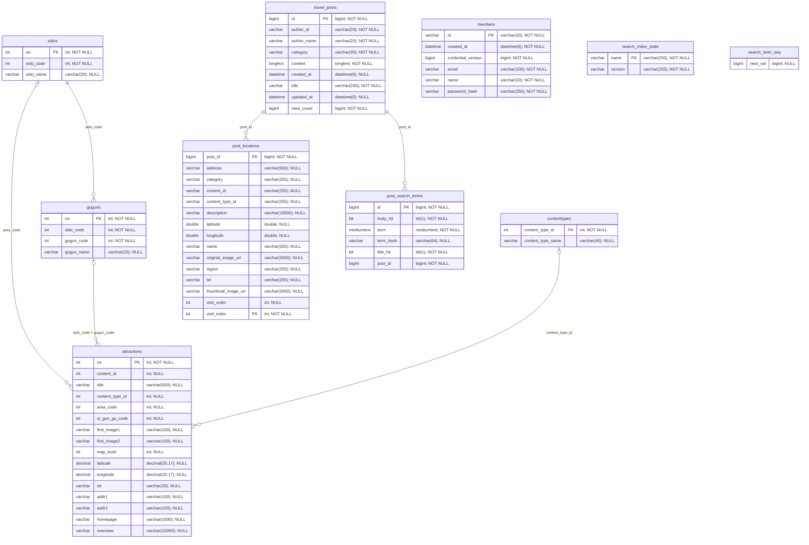

# 데이터베이스 ERD

제작자: 박시온, 이하람

`01-schema.sql`과 `03-application-schema.sql`의 전체 10개 테이블·컬럼을 반영한 모델입니다.

## 관계와 제약 조건

- `sidos.sido_code`는 유일키이며 구군·관광지에서 참조합니다.
- `guguns(sido_code, gugun_code)`는 복합 유일키입니다. 관광지는 `(area_code, si_gun_gu_code)`로 참조하여 시도별 중복 구군 코드를 구분합니다.
- `contenttypes.content_type_id`는 관광 유형 참조 키입니다.
- `members.email`은 유일합니다.
- `post_locations(post_id, visit_index)`는 복합 기본키입니다.
- `post_search_terms(term_hash, post_id)`는 복합 유일키이며 게시글 삭제 시 토큰도 삭제합니다.
- `travel_posts.author_id`와 `members.id`의 연결은 서비스가 관리합니다. 샘플 게시글의 작성자는 실제 회원이 아닐 수 있어 물리 FK는 없습니다. 회원 탈퇴 시 서비스가 작성 게시글과 검색 토큰을 삭제합니다.
- `post_locations`는 외부 API 관광지도 보관하는 방문지 스냅샷이므로 관광지 테이블에 물리 FK를 두지 않습니다.
- `search_index_state`는 재색인 버전을, `search_term_seq`는 Hibernate의 검색 토큰 ID 생성을 관리합니다.

정확한 인덱스·기본값·FK 정의는 [관광지 DDL](01-schema.sql)과 [애플리케이션 DDL](03-application-schema.sql)을 확인하세요.
