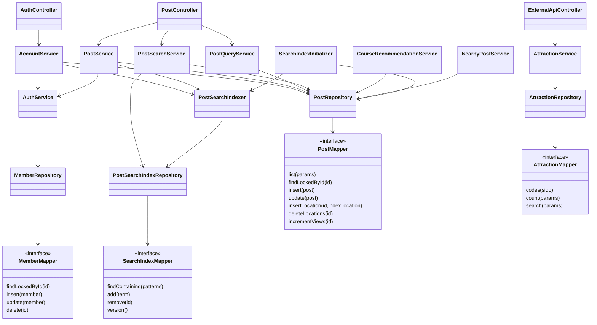

# Spring / MyBatis 클래스 및 트랜잭션 설계

## 클래스 다이어그램

`@Mapper` 인터페이스의 FQCN과 XML `namespace`, 메서드명과 SQL `id`가 일치한다. MyBatis Spring Boot Starter가 Mapper 프록시를 등록한다. `Repository`는 장소 목록 조립 등 DAO 어댑터 역할을 수행한다. `Member`, `TravelPost`, `PostLocation`은 JPA 엔티티가 아닌 일반 자바 객체다.

설정 방식은 [MyBatis Spring Boot 공식 문서](https://mybatis.org/spring-boot-starter/mybatis-spring-boot-autoconfigure/)를 따른다. Boot 3.5 환경에서 Starter 3.0.5를 사용한다. `map-underscore-to-camel-case`로 DB 컬럼을 매핑하고 `local-cache-scope=STATEMENT`로 여러 쿼리 사이 캐시 오염을 방지한다. 관광 응답은 명시적 `resultMap`으로 기존 TourAPI 필드명과 null을 보존한다.

## 트랜잭션 경계

| 작업 | 경계와 원자성 | 잠금·실패 처리 |
| --- | --- | --- |
| 관광·일반 목록·회원 조회 | 읽기 전용 서비스 트랜잭션 | SQL 바인딩, 입력 범위 검사 |
| 게시글 생성 | `PostService.create`: 글 + 장소 + 검색 인덱스 | 회원 행 `FOR UPDATE`; 탈퇴와 생성 직렬화 |
| 게시글 수정 | `PostService.update`: 본문 수정 + 기존 장소 교체 + 검색 인덱스 교체 | 회원 → 게시글 순서로 행 잠금; 작성자 검사; 실패 시 전부 롤백 |
| 게시글 삭제 | `PostService.delete`: 인덱스 + 장소 + 글 삭제 | 회원 → 게시글 순서로 행 잠금; 작성자 검사 |
| 상세 조회 | `PostService.detail`: 조회수 변경이므로 쓰기 트랜잭션 | 글 행 잠금 후 SQL에서 `view_count + 1`; 장소는 다시 저장하지 않음 |
| 회원 탈퇴 | `AccountService.withdraw`: 인덱스 + 작성 글/장소 + 회원 삭제 | 회원 행 잠금; 삭제 실패 시 전체 롤백; 커밋 후 세션 종료 |
| 비밀번호 변경·재설정 | 해시와 `credential_version`을 함께 갱신 | 회원 행 잠금; 커밋 후 현재 세션 버전 갱신 또는 종료 |
| 검색·코스 추천·주변 추천 | 읽기 전용 `REPEATABLE_READ` (InnoDB 일관된 스냅샷) | 여러 SQL이 첫 읽기 시점의 같은 스냅샷을 보며, 공유 잠금을 걸지 않아 쓰기를 막지 않음. 이전 `SERIALIZABLE`은 부하 시 교착 상태를 일으켜 변경(docs/LOAD_TEST.md) |
| 검색 인덱스 갱신 | `PostSearchIndexer`: `MANDATORY` | 호출자의 트랜잭션 없이는 실행 불가 |
| 기존 글 인덱스 재구축 | `SearchIndexInitializer.run` 전체 트랜잭션 | 100개 단위 조회, 완료 후 버전 기록; 실패 시 롤백 |

Spring의 JDBC 트랜잭션 관리자가 MyBatis 연결을 공유한다. 기본 `REQUIRED` 전파로 DAO 호출은 서비스 트랜잭션에 참여한다. 런타임 예외와 SQL 예외는 롤백된다. `AfterCommit`은 DB 커밋에 종속된 로그인 정보 변경·세션 종료를 커밋 이후 실행한다. 비밀번호 재설정의 실패 횟수·유효시간은 기존 세션 정책을 유지한다.

## 조회 성능과 데이터 호환성

- 게시글 목록과 장소 스냅샷은 일괄 조회한다. 게시글마다 추가 조회하는 N+1 방식을 사용하지 않는다.
- 주변 추천은 경계 상자 안의 위치 projection과 상위 게시글 요약을 총 2회 조회한다. 추천 후보별 장소 로딩 없이 기존 알고리즘을 유지한다.
- 신규 스키마에는 작성자·생성일·좌표·콘텐츠 ID 인덱스를 둔다. 기존 MySQL 테이블은 `CREATE TABLE IF NOT EXISTS`로 보존하며 기존 인덱스도 유지한다.
- 기존 `members`, `travel_posts`, `post_locations` 컬럼을 그대로 사용한다. 기존 장소 테이블이 cascade를 갖지 않은 경우에도 명시적으로 장소부터 삭제한다.
- 검색 인덱스는 새 `post_search_postings` 테이블에 작성한다. 기존 Hibernate의 sequence 기반 `post_search_terms`를 직접 변형하지 않는다. 인덱스 버전 변경으로 기존 게시글에서 자동 재구축한다. 이전 인덱스 테이블·sequence는 보존하며 자동 삭제하지 않는다.
- `schema*.sql`은 테이블이 없을 때 생성하는 초기화 스크립트다. 이미 존재하는 임의의 다른 스키마를 자동 교정하는 마이그레이션 도구는 아니다.

## 검증

`TransactionIntegrationTest`는 Mapper에 강제 예외를 주입해 생성·수정·탈퇴의 롤백을 확인한다. 기존 검색 테스트는 동시 쓰기 중 읽기 스냅샷 일관성도 확인한다. 추천 테스트는 MyBatis SQL 인터셉터로 실제 prepare 횟수를 측정하여 기존 성능 조건을 유지한다.
